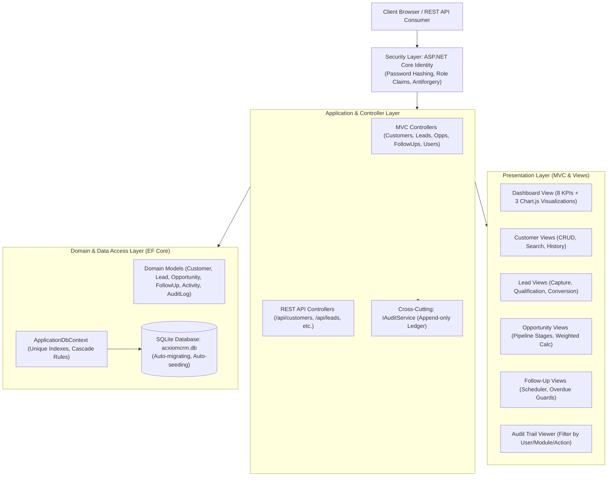

# AcxiomCRM: Enterprise Role-Based Sales & Relationship Governance Platform

A production-grade, multi-tenant enterprise Customer Relationship Management (CRM) application engineered to satisfy **Acxiom's Complete Functional & Technical Project Specification**. 

Built with **ASP.NET Core 11 (MVC + Web API)**, **Entity Framework Core**, **ASP.NET Core Identity**, **SQLite**, and **Bootstrap 5 + Chart.js**.

---

## 🏛️ Application Architecture & Layering



---

## 💎 The 6 Mandatory Security & Business Rules Implemented

| Area | Business Rule | Implementation & Test Result |
| :--- | :--- | :--- |
| **Authentication & Lockout** | Min 8 chars, 1 uppercase, 1 digit; Lockout after 3 failed attempts | ASP.NET Core Identity lockout configured; 5 min backoff. |
| **Role-Based Scoping** | • Admin: full system & audit<br>• Manager: team view<br>• Sales: assigned only | Scoped Linq queries + `[Authorize(Roles = "...")]` filters on controllers. |
| **Opportunity Amount** | Must be $> 0$ for active deals | Model validation + server-side validation rejects $\le 0$ with HTTP 400. |
| **Win Probability** | Must be strictly between $0$ and $100$ | Range check on client & server; derives weighted pipeline ($Amount \times Prob / 100$). |
| **Close Date Guard** | Expected close date cannot be in the past | Custom business check rejecting past dates. |
| **Follow-Up Guard** | Planned follow-up date cannot be earlier than today | Rejected on form submit and API with clear validation alert. |
| **Customer Deduplication** | Email and Phone must be 100% unique | Database unique constraints + service-level duplicate checks return HTTP 409 Conflict. |
| **Lead Conversion** | Convert qualified leads to Customer & Opportunity | Atomic conversion workflow updates status to `Converted` and links generated IDs. |

---

## 🔑 Pre-Seeded Test Credentials

The database automatically initializes and seeds all required roles and realistic enterprise records on launch:

| Role | Username / Email | Password | Access Scope |
| :--- | :--- | :--- | :--- |
| **Administrator** | `admin@acxiom.com` | `Admin@123` | Full system access, User/Role Admin, System Audit Logs, all CRM records |
| **Sales Manager** | `manager@acxiom.com` | `Manager@123` | Team pipeline, all opportunities, conversion reports, management analytics |
| **Sales Executive** | `sales@acxiom.com` | `Sales@123` | Strictly scoped to assigned customers, leads, follow-ups, and active deals |
| **Sales Executive 2** | `sales2@acxiom.com` | `Sales@123` | Secondary sales account for testing role isolation and data privacy |

---

## ⚡ How to Run

```bash
# 1. From the project directory:
cd /Users/viveknegi/.gemini/antigravity/scratch/acxiom_crm

# 2. Run the startup script:
./run.sh

# 3. Open in your browser:
# http://localhost:5072
```

---

## 📡 REST API Reference

All endpoints return strongly typed DTOs with standardized HTTP status codes (`200 OK`, `201 Created`, `400 Bad Request`, `409 Conflict`):

* `GET /api/customers` — List/search customers
* `POST /api/customers` — Create customer with duplicate checks
* `GET /api/customers/{id}` — Get single customer
* `PUT /api/customers/{id}` — Update customer details
* `DELETE /api/customers/{id}` — Soft delete / deactivate customer
* `GET /api/leads` — List all captured leads
* `POST /api/leads` — Capture new lead
* `GET /api/opportunities` — List sales opportunities
* `POST /api/opportunities` — Create opportunity with amount and probability validation
* `GET /api/followups` — List scheduled follow-ups
* `POST /api/followups` — Schedule follow-up with past-date prevention
* `GET /api/reports/pipeline` — Stage-wise count, total amount, and probability-weighted pipeline
